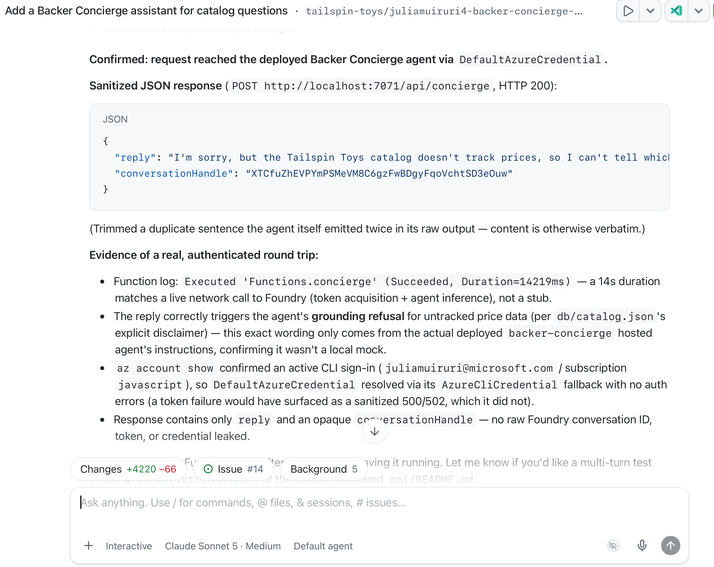
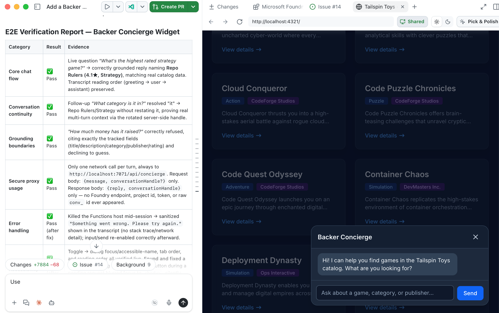

Este último módulo conecta el agente hospedado probado en [Crear e implementar el agente][previous-module] con el sitio web de Tailspin Toys que se ejecuta en local.

Al terminar, tendrás:

- Un proxy local de Azure Functions que protege las credenciales de Foundry y los identificadores de conversación.
- Un widget de chat accesible con un comportamiento verificado de extremo a extremo.
- Una integración verificada en local y un punto de control de limpieza de recursos.

## Escenario

Quienes apoyan los juegos de Tailspin Toys necesitan asesoramiento sobre el catálogo donde consultan los juegos. Backer Concierge debe conservar la conversación, funcionar con la navegación por teclado y gestionar de forma clara los errores y la información no disponible. Esa comodidad no debe exponer al navegador las credenciales del servicio ni los detalles internos de la conversación.

## Retomar el punto de control del agente hospedado

La integración utiliza el agente hospedado existente en lugar de crear nuevos recursos de Foundry.

1. Retoma el mismo repositorio de Tailspin Toys, la misma rama del worktree y la misma sesión de la incidencia **Add a Backer Concierge assistant for catalog questions** de los módulos anteriores. Confirma que estén presentes el archivo `azure.yaml` de la raíz, el código fuente del agente y el catálogo, y comprueba la suscripción registrada, el grupo de recursos dedicado, el proyecto de Foundry, la implementación del modelo y la versión probada del agente hospedado.
2. Si se eliminaron los recursos, restaura el [proyecto y el modelo][project-module] y la [implementación hospedada probada][previous-module] que correspondan antes de realizar la integración.

## Crear el proxy del lado del servidor

Tailspin Toys está completamente prerrenderizado. El código del navegador nunca debe llamar directamente al agente hospedado ni recibir credenciales de Foundry. Un **límite de protección de credenciales del lado del servidor**, implementado con Azure Functions en local, se autentica en Foundry y devuelve al navegador solo la respuesta del agente. El navegador envía cada mensaje con una referencia opaca a la conversación; el proxy asocia esa referencia con la conversación de Foundry sin exponer el identificador subyacente.

El proxy es la única parte del código que puede acceder a las credenciales de Azure. En este taller, la función y el sitio se ejecutan en local, y el servidor de desarrollo de Astro reenvía las solicitudes de `/api` a la función.

> [!IMPORTANT]
> Este proxy del taller es solo para desarrollo local. No debe implementarse como un punto de conexión público anónimo. Una integración de producción necesita un diseño de autenticación y control de abusos específico de la aplicación que incluya límites de frecuencia o cuotas adecuados, restricciones de CORS, supervisión y controles de costes.

3. En la misma sesión de Copilot, introduce:

   ```plaintext
   Añade en `api` un proxy local de Azure Functions para que el sitio estático de Astro pueda llamar a mi Backer Concierge implementado durante el desarrollo. Utiliza mi sesión local de Azure, mantén las credenciales y los identificadores de conversación de Foundry fuera del navegador, devuelve un identificador de conversación opaco, valida las solicitudes, sanea los errores y añade pruebas específicas. Configura el servidor de desarrollo de Astro para que las solicitudes a `/api` lleguen a la Function local. No crees infraestructura pública de implementación.
   ```

4. Revisa el proxy generado y las pruebas específicas para comprobar la validación de solicitudes, los errores sin datos sensibles, las referencias opacas a las conversaciones y el límite de protección de credenciales exclusivo del servidor. Pide a Copilot que ejecute las pruebas específicas y corrija cualquier fallo.
5. Abre otro terminal, inicia la función local con el comando proporcionado por Copilot y déjala en ejecución.
6. Vuelve al chat y pide a Copilot que pruebe el proxy local:

   ```plaintext
   Prueba el endpoint local `/api/concierge` con la pregunta «¿Qué juegos cuestan menos de 30 $?». Muéstrame la respuesta saneada y confirma que no se devuelven credenciales ni identificadores internos de conversación.
   ```

7. Inspecciona la respuesta: debería explicar que el catálogo no contiene precios. Confirma que no contiene ningún token de Foundry, credencial, identificador interno de conversación, punto de conexión del proyecto ni traza de la pila. Si no se puede acceder a la función, o la respuesta filtra detalles o inventa precios, envía el fallo sin datos sensibles a Copilot, corrígelo y vuelve a ejecutar las pruebas del proxy antes de continuar.

   

## Crear y probar el widget de chat

Con el proxy en ejecución, el widget muestra la conversación en el sitio sin exponer detalles de Foundry.

8. Pide a Copilot que cree la integración del sitio:

   ```plaintext
   Añade al sitio Astro un widget de chat accesible de Backer Concierge. Conéctalo a `/api/concierge`, conserva la conversación mediante el identificador opaco devuelto, sigue las directrices de diseño existentes, permite usarlo con el teclado, mantén los detalles de Foundry fuera del navegador y añade pruebas de extremo a extremo que cubran el flujo del chat, la continuidad de la conversación, la accesibilidad, el tratamiento de errores y los límites de fundamentación.
   ```

9. Inicia el servidor de desarrollo de Astro en otro terminal con el comando proporcionado por Copilot. Mantén en ejecución tanto el sitio como la función local.
10. Pide a Copilot que ejecute las pruebas de extremo a extremo:

    ```plaintext
    Ejecuta las pruebas de extremo a extremo del widget Backer Concierge en el sitio de Tailspin Toys. Comprueba el flujo básico del chat, la continuidad de la conversación, la accesibilidad, el tratamiento de errores, los límites de fundamentación y el uso seguro del proxy local. Informa de los resultados e incluye pruebas de los fallos que encuentres.
    ```

11. Revisa el informe y verifica en el navegador el comportamiento que describe, incluido el uso del teclado y la conversación de dos turnos de las [comprobaciones de aceptación del agente hospedado][agent-checks]. Confirma que las solicitudes del navegador pasan por `/api/concierge` con una referencia opaca, no directamente a Foundry, y que las respuestas no exponen credenciales ni identificadores internos de Foundry. Comprueba que las recomendaciones y las respuestas sobre datos ausentes se mantengan dentro de los límites del catálogo. Resuelve las pruebas fallidas con Copilot, reinicia el servicio local afectado si es necesario y vuelve a ejecutar las pruebas.

    

## Punto de control y pasos siguientes

Has creado un proxy local que protege las credenciales, conectado un widget de chat accesible y verificado el flujo completo de la conversación con el Backer Concierge hospedado. El punto de control de este módulo es una integración del sitio web probada en local que conserva los límites del catálogo y mantiene las credenciales y los identificadores internos de Foundry fuera del navegador. No es una implementación de producción del proxy ni del sitio.

Cuando termines de experimentar, detén ambos servicios locales y [limpia los recursos de Azure][cleanup]. Después, continúa con [Repaso y pasos siguientes][core-review] en la ruta principal del taller.

[previous-module]: ../2-build-and-deploy/
[project-module]: ../1-project-and-model/
[agent-checks]: ../2-build-and-deploy/#inspeccionar-el-agente-en-local
[cleanup]: ../#limpiar-los-recursos
[core-review]: ../../10-review/
