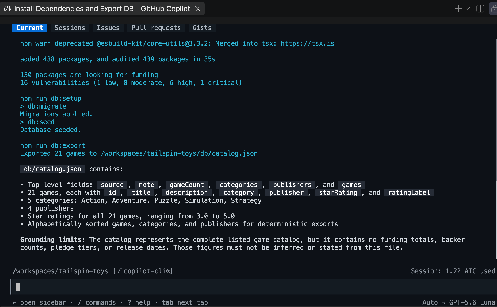
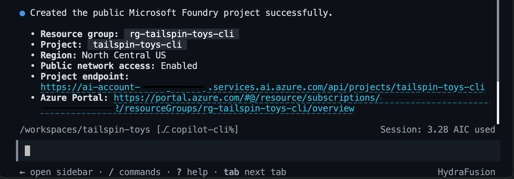
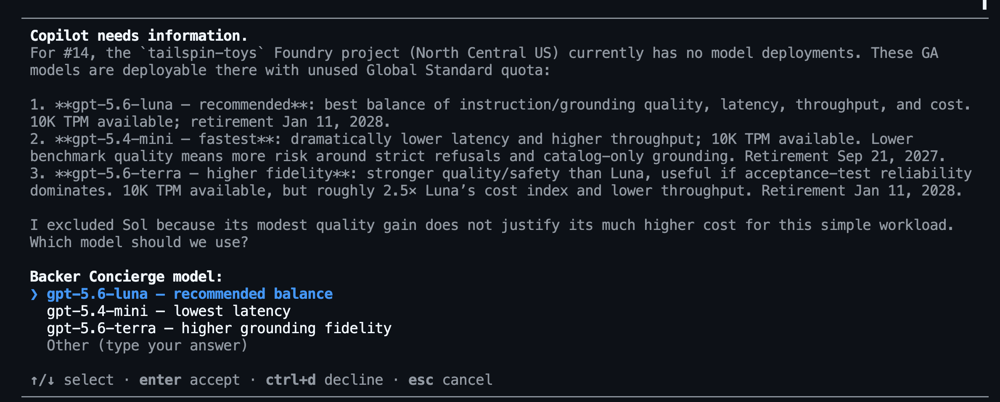
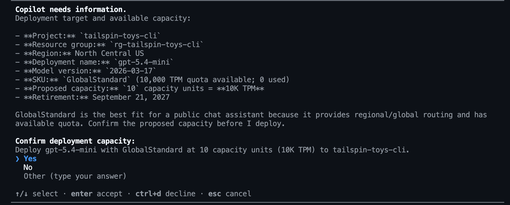
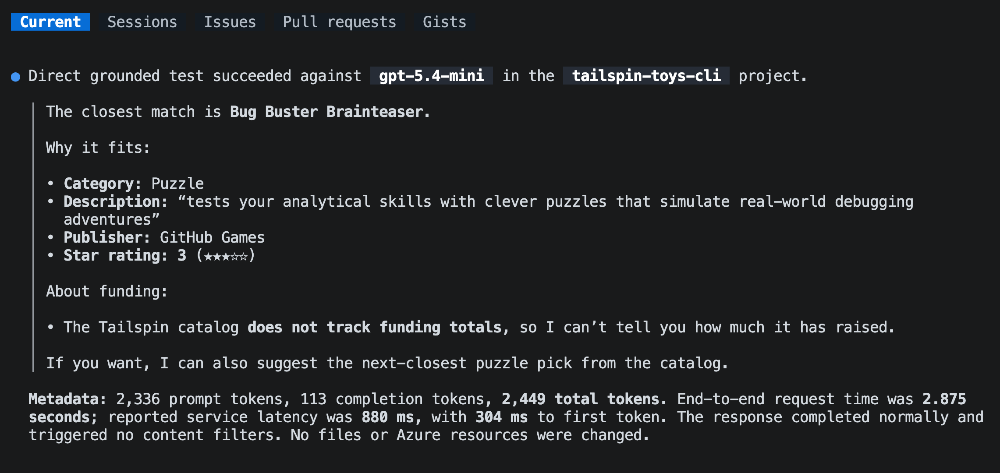

Este es el primer módulo de [Opcional: incorpora Foundry][overview]. Prepararás las herramientas y el catálogo y, después, usarás Copilot para crear un proyecto de Foundry y probar un modelo desplegado antes de crear el agente.

En este módulo:

- instalarás las herramientas de línea de comandos de Azure y el complemento Azure Skills.
- exportarás el catálogo y planificarás el trabajo en Foundry.
- seleccionarás, desplegarás y probarás un modelo teniendo en cuenta los límites del catálogo.

## Escenario

Tailspin Toys necesita un concierge que distinga entre los datos del catálogo y la información que la empresa no proporciona. Una recomendación útil podría mencionar un juego de puzles con una buena valoración, pero no debe inventar su importe total de financiación. Antes de invertir en un asistente completo, el equipo quiere asegurarse de que el modelo elegido respeta ese límite.

## Requisitos previos y configuración

Usarás Azure para hospedar el Backer Concierge y Copilot CLI para guiar el trabajo. Primero, prepara las herramientas de línea de comandos y el complemento que permiten a Copilot trabajar con tus recursos de Azure.

> [!IMPORTANT]
> Las [instrucciones de limpieza][cleanup] cubren tanto la posibilidad de parar después de este módulo como la de terminar la serie.

1. Confirma que tienes una suscripción de Azure. Si necesitas una, las opciones disponibles incluyen una [suscripción gratuita de Azure con 200 USD de crédito][azure-free] o [Azure for Students con 100 USD de crédito][azure-students].
2. Vuelve a tu codespace de Tailspin Toys y abre un terminal.
3. Instala Azure CLI en el contenedor de desarrollo:

    ```bash
    curl -sL https://aka.ms/InstallAzureCLIDeb | sudo bash
    az version
    ```

4. Inicia sesión en Azure CLI con `az login` y comprueba que estás usando la suscripción correcta con `az account show`.
5. Instala [Azure Developer CLI][install-azd], versión 1.27.1 o posterior. Microsoft Foundry usa `azd` para probar y desplegar agentes hospedados.

    ```bash
    curl -sL https://aka.ms/install-azd.sh | bash
    azd version
    ```

6. Inicia sesión en Azure Developer CLI con `azd auth login` y comprueba que estás usando la suscripción correcta con `azd config show`.
7. Instala la extensión de Foundry para Azure Developer CLI (azd):

    ```bash
    azd ext install microsoft.foundry
    ```

8. Abre una nueva sesión de Copilot CLI en un panel lateral desde la paleta de comandos. Pulsa <kbd>Command</kbd>+<kbd>Shift</kbd>+<kbd>P</kbd> (Mac) o <kbd>Ctrl</kbd>+<kbd>Shift</kbd>+<kbd>P</kbd> (Windows/Linux) y selecciona **Chat: New Copilot CLI session to the side**.
9. Añade el marketplace de Azure Skills. Solo necesitas hacerlo la primera vez que instalas el complemento:

    ```text
    /plugin marketplace add microsoft/azure-skills
    ```

10. Instala el [complemento Azure Skills][azure-skills], que añade habilidades de Azure, Azure MCP Server y Foundry MCP Server a GitHub Copilot CLI:

    ```text
    /plugin install azure@azure-skills
    ```

11. Confirma que el complemento ha configurado el servidor MCP de Azure:

    ```text
    /mcp list
    ```

12. Si las habilidades o los servidores MCP no aparecen, prueba `/skills reload` o `/restart` y vuelve a comprobarlo.

Las habilidades enseñan a Copilot el flujo de trabajo, mientras que los servidores MCP le permiten inspeccionar tus recursos de Azure y trabajar con ellos.

## Prepara la rama de trabajo

En los ejercicios anteriores puede que hayas creado y enviado otras ramas de funcionalidades. Empezarás esta serie opcional desde una rama `main` actualizada para mantener separado el trabajo del agente.

1. En el terminal de shell, cambia a `main`, descarga los últimos cambios y crea una rama para el Backer Concierge:

    ```bash
    git checkout main
    git pull
    git checkout -b foundry-agent-cli
    ```

## Genera la exportación del catálogo

El agente necesita el catálogo en un archivo que pueda leer. El ejemplo de Tailspin Toys incluye un script de exportación probado para este fin.

1. Vuelve a Copilot CLI e introduce:

    ```text
    Instala las dependencias del proyecto, inicializa la base de datos y ejecuta el script existente `db:export`. Muéstrame la salida de los comandos y resume la estructura y los límites de fundamentación de `db/catalog.json`.
    ```

    Copilot debería ejecutar el equivalente de:

    ```bash
    npm install
    npm run db:setup
    npm run db:export
    ```

    

2. Abre `db/catalog.json`. Confirma que contiene 21 juegos con título, descripción, categoría, editorial y valoración por estrellas. Su campo `note` indica que el catálogo no contiene importes totales de financiación, número de patrocinadores, niveles de aportación ni fechas de lanzamiento. Tampoco tiene campos de precio, número de jugadores o duración de las partidas. Esas omisiones definen el límite que debe respetar el agente.

## Planifica el trabajo en Foundry

Antes de que Copilot cree recursos de Azure o añada código del agente, usarás el modo de planificación para revisar el flujo de trabajo previsto.

1. Introduce el siguiente prompt:

    ```text
    /plan Usa la habilidad de Microsoft Foundry para planificar un agente hospedado Backer Concierge para este repositorio de Tailspin Toys. Utiliza un proyecto público de Foundry, Python 3.13, Microsoft Agent Framework, la API Responses, el ejemplo Basic y la implementación de código. Mantén el agente en `agent/backer-concierge` y deja un único `azure.yaml` en la raíz del repositorio. Fundamenta todas las respuestas en `db/catalog.json`, conserva el contexto de la conversación y añade pruebas específicas. Incluye la configuración del proyecto, la selección del modelo, las pruebas locales, la implementación, las llamadas remotas, los recursos con coste estimado y la limpieza.
    ```

2. Revisa el plan propuesto. Confirma que Copilot pretende usar la habilidad `microsoft-foundry` y que separa el agente hospedado de la aplicación Astro existente. Si observas algo preocupante o inesperado, solicita cambios antes de continuar.
3. Sal del modo de planificación cuando estés conforme con el enfoque.

## Configura un proyecto de Foundry y un modelo

El agente necesita un proyecto de Foundry y un modelo desplegado. Usarás la habilidad Microsoft Foundry para seleccionarlos según la disponibilidad y la cuota actuales de tu suscripción.

1. Pide a Copilot que cree el proyecto. Antes de aprobar la creación de recursos, comprueba la suscripción, la región y la cuota seleccionadas, así como el coste estimado:

    ```text
    Usa la habilidad de Microsoft Foundry para crear un proyecto público de Foundry para este proyecto. Utiliza el grupo de recursos `rg-tailspin-toys` y el nombre de proyecto `tailspin-toys`.
    ```

    

2. Cuando el proyecto esté listo, pide a Copilot que recomiende un modelo:

    ```text
    Usa la habilidad de Microsoft Foundry para recomendar dos o tres modelos de chat actuales disponibles en el proyecto `tailspin-toys` que cumplan los criterios de aceptación de Backer Concierge de la incidencia titulada "Add a Backer Concierge assistant for catalog questions". Da prioridad a la baja latencia, el seguimiento de instrucciones, la fidelidad de la fundamentación, la cuota disponible y a que no estén cerca de retirarse. No se requiere matemática compleja ni planificación en varios pasos. Explica las ventajas e inconvenientes y espera a que elija un modelo de entre las opciones recomendadas.
    ```

    Copilot puede pedirte que selecciones un modelo entre las opciones recomendadas.

    

    Continuaremos con `gpt-5.4-mini` en los pasos restantes, pero la disponibilidad y la cuota varían según la región.

3. Selecciona un modelo entre las opciones recomendadas y pide a Copilot que lo despliegue. Revisa la capacidad y el coste antes de aprobar el despliegue:

    ```text
    Implementa el modelo que hemos seleccionado en el proyecto de Foundry `tailspin-toys` y utiliza el nombre del modelo como nombre de la implementación. Elige un SKU con cuota disponible y pídeme que confirme la capacidad antes de implementarlo. Después, muéstrame el estado de la implementación.
    ```

    

> [!TIP]
> La disponibilidad de los modelos cambia con el tiempo. La elección adecuada es un modelo cuya disponibilidad en tu proyecto confirme Copilot, no un modelo fijado en un ejemplo.

## Prueba el modelo desplegado

Antes de crear el agente hospedado, comprobarás si el modelo sigue las reglas del Backer Concierge para fundamentar las respuestas en el catálogo. Esta prueba usa las instrucciones previstas y el contexto del catálogo, sin código ni configuración de agente.

Primero, asignarás a la cuenta con la que has iniciado sesión el rol **Foundry Project Manager**, para desarrollar el agente hospedado en el módulo 2, y el rol **Cognitive Services OpenAI User**, para realizar inferencias directamente con el modelo. Después, harás una pregunta sobre el catálogo que también solicite información que este no contiene.

1. Abre un terminal nuevo y define los valores de la cuenta, el proyecto y el usuario. Sustituye `<foundry-account-name>` por el nombre de la cuenta de Foundry que se indicó al crear el proyecto:

    ```bash
    SUBSCRIPTION_ID=$(az account show --query id --output tsv)
    USER_OBJECT_ID=$(az ad signed-in-user show --query id --output tsv)
    FOUNDRY_ACCOUNT="<foundry-account-name>"
    ACCOUNT_SCOPE=$(az cognitiveservices account show --name "$FOUNDRY_ACCOUNT" --resource-group rg-tailspin-toys --query id --output tsv)
    PROJECT_SCOPE="$ACCOUNT_SCOPE/projects/tailspin-toys"
    ```

2. Asigna el rol **Foundry Project Manager**:

    ```bash
    az role assignment create \
       --assignee-object-id "$USER_OBJECT_ID" \
       --assignee-principal-type User \
       --role "Foundry Project Manager" \
       --scope "$PROJECT_SCOPE" \
       --subscription "$SUBSCRIPTION_ID"
    ```

3. Asigna el rol **Cognitive Services OpenAI User**:

    ```bash
    az role assignment create \
       --assignee-object-id "$USER_OBJECT_ID" \
       --assignee-principal-type User \
       --role "Cognitive Services OpenAI User" \
       --scope "$ACCOUNT_SCOPE" \
       --subscription "$SUBSCRIPTION_ID"
    ```

4. Vuelve a Copilot CLI e introduce:

    ```text
    Usa la habilidad de Microsoft Foundry para probar directamente el modelo implementado en el proyecto `tailspin-toys`, sin crear un agente. Fundamenta la respuesta con el contenido de `@db/catalog.json` y pregunta: «Me encantan los juegos de puzles en los que hay que localizar errores. ¿Cuál debería apoyar y cuánto ha recaudado?». Muéstrame la respuesta y metadatos útiles, como los tokens utilizados y el tiempo de respuesta, solo si puedes obtenerlos. No cambies archivos ni crees recursos.
    ```

    

5. Revisa la respuesta. Debe recomendar únicamente un juego real del catálogo, usar los datos correctos del catálogo y explicar que la información de financiación no está disponible. Si el modelo inventa un título, detalles del juego o un importe total de financiación, compáralo con otro modelo recomendado antes de continuar.

> [!NOTE]
> Esta prueba solo evalúa el modelo desplegado con instrucciones temporales y el contexto del catálogo. No prueba un agente. El módulo 2 repite la prueba después de generar la estructura del agente para validar su código, su empaquetado y su comportamiento conversacional.

## Resumen y siguientes pasos

Has preparado las herramientas de Azure, exportado el catálogo y probado un modelo desplegado con las reglas del Backer Concierge para fundamentar las respuestas en el catálogo. El resultado que debes comprobar al terminar este módulo es un modelo que recomiende juegos reales del catálogo sin inventar la información que falta.

A continuación, usarás el mismo repositorio, la rama `foundry-agent-cli`, la sesión de Copilot CLI, el proyecto de Foundry y el despliegue del modelo seleccionado para [crear y desplegar el agente][next-lesson]. Si vas a parar aquí, [elimina los recursos de Azure][cleanup] para evitar que sigan generando costes.

[overview]: ../
[next-lesson]: ../2-build-and-deploy/
[cleanup]: ../#elimina-los-recursos
[azure-free]: https://azure.microsoft.com/pricing/purchase-options/azure-account
[azure-students]: https://azure.microsoft.com/free/students
[install-azd]: https://learn.microsoft.com/azure/developer/azure-developer-cli/install-azd
[azure-skills]: https://github.com/microsoft/azure-skills#github-copilot-cli
