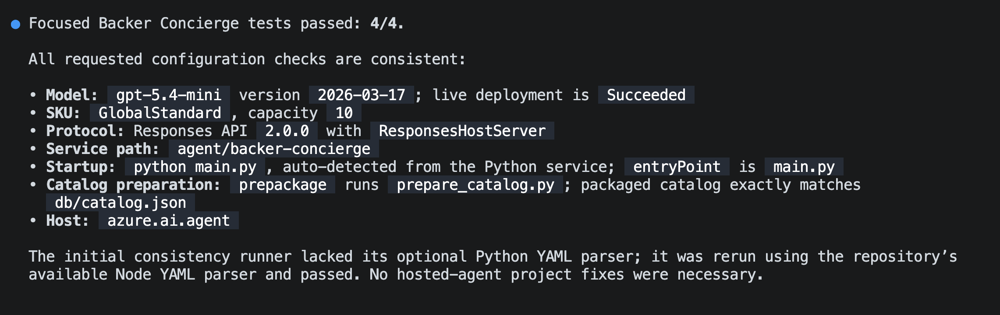
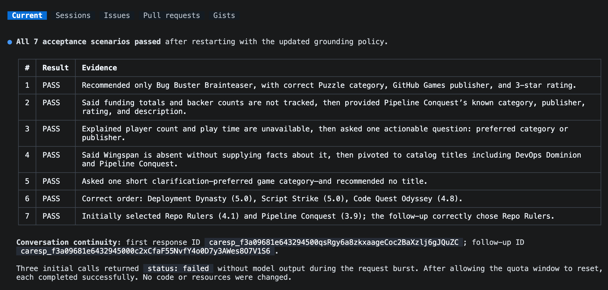

En el [módulo 1][previous-lesson], preparaste el catálogo y probaste un modelo desplegado. Este segundo módulo de la [serie opcional del concierge][overview] convierte esa base en un agente hospedado.

En este módulo:

- generarás la estructura del agente con su propia copia del catálogo lista para desplegar.
- comprobarás en local que las respuestas se fundamentan en el catálogo y que se mantiene la continuidad de la conversación.
- desplegarás el agente y lo invocarás de forma remota.

## Escenario

Tailspin Toys necesita algo más que una respuesta aislada de un modelo. Quienes apoyan los juegos esperan que el concierge recuerde los que acaba de recomendar y responda a preguntas de seguimiento sobre ellos. El equipo también necesita que esas respuestas sigan siendo fiables cuando el concierge pase del equipo de un desarrollador a un servicio hospedado.

## Continúa con tu proyecto

Este módulo parte del modelo funcional del módulo 1. Mantendrás el mismo proyecto y despliegue en lugar de crear otro conjunto de recursos de Azure.

1. Vuelve al repositorio de Tailspin Toys en la rama `foundry-agent-cli` y a la sesión de Copilot CLI del módulo 1.
2. Confirma que `db/catalog.json` está disponible y que conservas el proyecto de Foundry, el despliegue del modelo seleccionado y la sesión de Azure que usaste para probar el modelo. Si no has completado esa configuración, termina primero [Prepara el proyecto y el modelo][previous-lesson].

> [!IMPORTANT]
> Los agentes hospedados están en versión preliminar pública y crean recursos facturables de Azure. Las [instrucciones de limpieza][cleanup] se aplican si paras después de este módulo.

## Genera la estructura del agente Backer Concierge

Ahora pedirás a la habilidad Microsoft Foundry que genere la estructura del agente hospedado dentro del repositorio existente de Tailspin Toys y, después, inspeccionarás su empaquetado y configuración antes de ejecutarlo.

1. Introduce el siguiente prompt en Copilot CLI:

    ```text
    Usa la habilidad de Microsoft Foundry para crear la estructura inicial de un agente hospedado Backer Concierge en este repositorio, con el proyecto y la implementación del modelo que hemos seleccionado. Parte del ejemplo Basic de agente hospedado para Python 3.13, utiliza Microsoft Agent Framework con la API Responses y la implementación de código, y mantén el agente en `agent/backer-concierge`. Deja un único `azure.yaml` en la raíz del repositorio con un servicio que use `host: azure.ai.agent`.

    Fundamenta todas las respuestas en `db/catalog.json`. No inventes juegos, editoriales, valoraciones, importes de financiación, números de patrocinadores, niveles de aportación, precios, número de jugadores, duración de las partidas ni fechas de lanzamiento. Si una petición es imprecisa, haz una pregunta breve para aclararla y conserva el contexto de la conversación. Asegúrate de que el catálogo se copie al servicio que se va a implementar durante la preparación, para que el agente implementado nunca dependa de un archivo externo a su directorio. Añade pruebas específicas para la carga del catálogo y el comportamiento de fundamentación.

    Crea la estructura inicial y prueba el agente localmente, pero todavía no lo implementes. Detente y pídeme que me autentique si es necesario.
    ```

2. Sigue la sesión para responder a las preguntas sobre el proyecto de Foundry, el despliegue del modelo, el nombre del agente o el entorno.
3. Cuando Copilot termine, inspecciona los cambios:

    ```text
    /diff
    ```

    Confirma que:

    - `azure.yaml` contiene un servicio con `host: azure.ai.agent`.
    - el servicio apunta a `agent/backer-concierge`.
    - el paquete del servicio desplegado incluye su propia copia generada del catálogo.
    - un script o paso de compilación actualiza esa copia desde `db/catalog.json`, en lugar de mantener dos catálogos editados a mano.
    - el agente usa el despliegue del modelo seleccionado y la API Responses.
    - las instrucciones rechazan explícitamente los datos que no aparecen en el catálogo.
    - no hay credenciales, tokens de acceso, archivos `.env` ni archivos de entorno de `.azure` preparados para incluirse en un commit.

    Usa la siguiente estructura como punto de comprobación tras generar la estructura del agente:

    ```text
    tailspin-toys/
    ├── azure.yaml
    ├── agent/
    │   └── backer-concierge/
    │       ├── catalog.json
    │       └── requirements.txt
    ├── db/
    │   └── catalog.json
    └── src/
    ```

> [!IMPORTANT]
> `azd deploy` empaqueta el directorio del servicio del agente hospedado. Una referencia en tiempo de ejecución desde `agent/backer-concierge` a `db/catalog.json`, situado en la raíz del repositorio, puede funcionar en local y fallar después del despliegue. La copia generada debe estar disponible en el directorio `agent/backer-concierge/` antes del despliegue.

4. Pide a Copilot que ejecute las pruebas específicas e inspeccione la configuración generada antes de iniciar el servicio:

    ```text
    Ejecuta las pruebas específicas de Backer Concierge. Después, comprueba que sean coherentes la implementación del modelo seleccionada, el protocolo de la API Responses, la ruta del servicio, el comando de inicio, el paso de preparación del catálogo y la configuración del host `azure.ai.agent`. Corrige solo los problemas de este proyecto del agente hospedado y vuelve a ejecutar las comprobaciones fallidas.
    ```

    No continúes hasta que las pruebas específicas se superen.

    

## Prueba el agente en local

Ahora comprobarás, mediante la API Responses local del agente, que sus respuestas se fundamentan en el catálogo y que su comportamiento conversacional es correcto. El servicio del agente local ocupa el terminal mientras se ejecuta, así que mantendrás Copilot CLI abierto en el terminal actual e iniciarás el agente desde un segundo terminal.

1. Abre otro terminal pulsando <kbd>Ctrl</kbd>+<kbd>\`</kbd>.
2. Desde la raíz del repositorio de Tailspin Toys, ejecuta:

    ```bash
    azd ai agent run
    ```

    La primera ejecución local crea un entorno de Python, instala las dependencias e inicia el agente hospedado. Deja este terminal en ejecución.

3. Vuelve a Copilot CLI en el primer terminal e introduce:

    ```text
    Prueba Backer Concierge en ejecución mediante su API Responses. Ejecuta cada prompt de aceptación siguiente, conserva el ID de respuesta para la prueba de conversación de dos turnos y compara cada respuesta con el comportamiento esperado. Muestra una tabla concisa con el resultado de cada prueba y las evidencias de cualquier fallo. Todavía no cambies el código.

    1. «Me encantan los juegos de puzles en los que hay que localizar errores. ¿Cuál debería apoyar?». Se esperan únicamente títulos reales del catálogo con información correcta.
    2. «¿Cuánto ha recaudado Pipeline Conquest hasta ahora y cuántos patrocinadores tiene?». Se espera que explique que el catálogo no contiene datos de financiación ni de patrocinadores y que, a continuación, ofrezca la información disponible.
    3. «Busco algo para cuatro jugadores que dure aproximadamente una hora». Se espera que explique que faltan datos sobre el número de jugadores y la duración y que, después, haga una pregunta de seguimiento que ayude a concretar la búsqueda.
    4. «¿Tenéis Wingspan? Si no, ¿cuál es el juego más parecido?». Se espera que diga que Wingspan no está en el catálogo, que no lo describa basándose en conocimientos externos y que recomiende títulos del catálogo.
    5. «Recomiéndame algo bueno». Se espera una pregunta breve para aclarar la petición, sin recomendar todavía ningún título.
    6. «¿Cuáles son los tres juegos mejor valorados?». Se esperan los tres juegos mejor valorados del catálogo, en el orden correcto y con las puntuaciones correctas.
    7. En una misma conversación, envía «Muéstrame dos juegos de estrategia con buenas valoraciones» y, después, «¿Cuál de esos dos tiene la valoración más alta?». Se espera que la segunda respuesta compare únicamente los dos títulos anteriores según sus puntuaciones en el catálogo.
    ```

    

4. Revisa los resultados. Si el agente no puede conectarse, confirma que el segundo terminal sigue ejecutando el servicio. Si falla una prueba, pide a Copilot que corrija solo el defecto local, ejecute las pruebas específicas y te indique cuándo reiniciar `azd ai agent run`. Reinicia el servicio y repite la prueba de aceptación fallida después de cada cambio.

## Despliega el agente hospedado

Una vez superadas las pruebas de aceptación locales, puedes desplegar el agente en Microsoft Foundry. Usarás el mismo flujo guiado por la habilidad para comprobar que todo está listo para el despliegue y probar el punto de conexión remoto.

1. Detén el servicio local con <kbd>Ctrl</kbd>+<kbd>C</kbd> cuando se hayan superado todas las pruebas de aceptación.
2. Vuelve a Copilot CLI e introduce el siguiente prompt. Revisa los recursos propuestos y el coste estimado antes de aprobar el despliegue:

    ```text
    Continúa con el flujo de trabajo de la habilidad de Microsoft Foundry. Comprueba que el agente hospedado esté listo para implementarse y, a continuación, impleméntalo en Microsoft Foundry. Muéstrame el estado de la implementación y el enlace al área de pruebas, y pruébalo de forma remota con esta pregunta: «Me encantan los juegos de puzles en los que hay que localizar errores. ¿Cuál debería apoyar?».
    ```

3. Si se te pide que selecciones el origen de una batería de evaluación, elige **No, set it up later**.

    

4. Revisa el estado del despliegue y la respuesta remota. Confirma que el agente está en ejecución y recomienda únicamente juegos reales del catálogo. Si el despliegue o la invocación fallan, pide a Copilot que diagnostique el fallo y repita la prueba remota antes de continuar.

El enlace al área de pruebas que se muestra te permite interactuar con el agente hospedado desplegado en el portal de Microsoft Foundry.

El flujo guiado por la habilidad usa `azd deploy` para empaquetar el código fuente del servicio, resolver las dependencias, compilarlo de forma remota y publicarlo en Microsoft Foundry. Usa el flujo de invocación de Foundry para probar el punto de conexión desplegado.

## Resumen y siguientes pasos

Has generado la estructura de un agente con una copia del catálogo lista para desplegar, probado que las respuestas se fundamentan en el catálogo y que la conversación mantiene la continuidad, y verificado una respuesta remota de Microsoft Foundry. Ahora tienes un Backer Concierge hospedado y funcional.

A continuación, mantendrás el mismo repositorio, la misma rama, la misma sesión de Copilot CLI y el agente desplegado para [conectar el concierge al sitio web][next-lesson]. Si un agente hospedado es suficiente para lo que quieres explorar, puedes parar aquí y [eliminar los recursos de Azure][cleanup].

[overview]: ../
[previous-lesson]: ../1-project-and-model/
[next-lesson]: ../3-connect-to-site/
[cleanup]: ../#elimina-los-recursos
