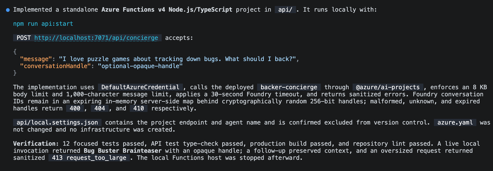
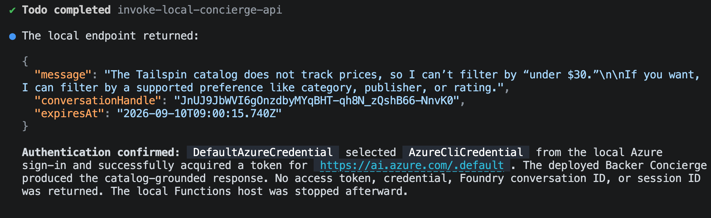

En el [módulo 2][previous-lesson], desplegaste y probaste el Backer Concierge. Este último módulo de la [serie opcional del concierge][overview] permite acceder a ese agente desde tu sitio web local de Tailspin Toys.

En este módulo:

- crearás un proxy local de Azure Functions que mantenga las credenciales de Foundry en el servidor.
- añadirás un widget de chat accesible al sitio.
- verificarás el flujo completo de conversación y eliminarás los recursos.

## Escenario

Quienes apoyan los juegos los descubren en el sitio web de Tailspin Toys, no en el terminal de un desarrollador ni en un portal de Azure. El equipo quiere que el concierge esté disponible junto al catálogo, con una experiencia de chat que admita preguntas de seguimiento y proteja las credenciales del servicio.

## Continúa con el agente hospedado

La integración con el sitio web necesita el agente desplegado del módulo 2. Mantendrás ese agente en ejecución en Foundry mientras el proxy y el sitio web se ejecutan en local.

1. Vuelve al repositorio de Tailspin Toys en la rama `foundry-agent-cli` y a la sesión de Copilot CLI existente.
2. Confirma que el Backer Concierge está desplegado y que la invocación remota de [Crea y despliega el agente][previous-lesson] se completó correctamente. Si ya has eliminado los recursos de Azure, vuelve a crearlos siguiendo los módulos anteriores antes de continuar.

> [!IMPORTANT]
> El proxy y el sitio web de este módulo se ejecutan en local; no se trata de un despliegue del sitio web en producción. El modelo y el agente hospedado siguen siendo recursos facturables de Azure hasta que completes la [limpieza][cleanup].

## Crea el proxy del lado del servidor

Tailspin Toys está completamente prerrenderizado. El código del navegador nunca debe llamar directamente al agente hospedado ni recibir credenciales de Foundry. Añadirás una función local de Azure Functions que actúe como **barrera de protección de credenciales del lado del servidor**: se autenticará en Foundry y devolverá al navegador únicamente la respuesta del agente.

La habilidad `microsoft-foundry` se encarga del flujo del agente hospedado, mientras que las habilidades más generales de Azure del mismo complemento pueden preparar el proyecto local de la función. Usarás esas habilidades para crear el proxy y, después, comprobarás que se conecta al agente sin exponer credenciales.

1. En Copilot CLI, introduce:

    ```text
    Utiliza las habilidades de Azure para añadir en `api` un proyecto de Azure Functions v4 con Node.js y TypeScript, con un único endpoint `POST /api/concierge` que invoque mi agente hospedado Backer Concierge ya implementado. Esta Function solo se ejecutará en local: no la añadas a `azure.yaml` ni crees infraestructura de implementación de Azure. Utiliza `DefaultAzureCredential` con mi sesión local de Azure. Mantén ligero el desencadenador HTTP, aísla el cliente de Foundry en un módulo que se pueda probar mediante pruebas unitarias, valida y limita los cuerpos de las solicitudes, establece tiempos de espera explícitos y devuelve errores saneados. Guarda el endpoint del proyecto de Foundry y el nombre del agente en ajustes locales del lado del servidor, excluidos del control de versiones. No devuelvas nunca credenciales ni tokens de acceso al navegador. El sitio Astro utiliza `output: 'static'` y no tiene proxy de desarrollo; añade también en `astro.config.mjs` un proxy local del servidor de desarrollo de Vite que reenvíe `/api` al puerto de la Function, para que las solicitudes relativas a `/api/concierge` lleguen a ella durante `astro dev`.

    Para el estado de la conversación, genera en el servidor un identificador de alta entropía, asígnalo a la conversación de Foundry en el servidor y establece su caducidad; no expongas nunca el identificador de conversación o de hilo sin procesar de Foundry. Rechaza los identificadores mal formados, caducados o desconocidos. Añade pruebas unitarias específicas.
    ```

    

2. Abre otro terminal e inicia la función local con el comando que te proporcione Copilot. Deja la función en ejecución.
3. Vuelve a Copilot CLI y pide a Copilot que pruebe el proxy local:

    ```text
    Envía al endpoint local `/api/concierge` una solicitud con la pregunta «¿Qué juegos cuestan menos de 30 $?» y muéstrame la respuesta JSON saneada. Confirma que la solicitud llega al agente Backer Concierge implementado mediante `DefaultAzureCredential`.
    ```

4. Inspecciona la respuesta. Debe explicar que el catálogo no contiene precios. No debe contener ningún token, credencial, punto de conexión del proyecto ni identificador de conversación sin procesar de Foundry, ni tampoco una traza de la pila.

    

## Crea el widget de chat

El proxy ofrece al navegador una forma segura de conectarse al concierge. Ahora añadirás un widget de chat al sitio y usarás Playwright para comprobar el flujo completo de conversación.

1. Pide a Copilot que cree la integración con el sitio:

    ```text
    Añade un widget de chat accesible de Backer Concierge como componente Astro e inclúyelo en todo el sitio desde `Layout.astro`. Debe enviar solicitudes `POST` a `/api/concierge` y mantener el hilo de la conversación mediante el identificador opaco devuelto, seguir el tema oscuro de `style.instructions.md`, permitir cerrarlo con Escape e incluir atributos `data-testid`.
    ```

2. Mantén la función local en ejecución e inicia el sitio Astro en otro terminal con el comando que te proporcione Copilot.
3. Vuelve a Copilot CLI. El servidor MCP de Playwright que añadiste en el [ejercicio 4][playwright-lesson] ya está disponible. Pide a Copilot que pruebe el widget:

    ```text
    Utiliza el servidor MCP de Playwright para probar de extremo a extremo el widget Backer Concierge en el sitio Tailspin Toys en ejecución. Comprueba el flujo básico del chat, la continuidad de la conversación, la accesibilidad, el tratamiento de errores, los límites de fundamentación y el uso seguro del proxy local. Informa de los resultados e incluye pruebas de los fallos que encuentres.
    ```

    

4. Revisa los resultados y las pruebas aportadas. Si alguna comprobación falla, pide a Copilot que corrija el comportamiento correspondiente del proxy o del widget y repita las comprobaciones fallidas antes de terminar.

## Elimina los recursos

Has llegado al último punto de comprobación: un concierge funcional en tu sitio web local. Las instrucciones de limpieza comunes cubren tanto los servicios locales como los recursos de Azure creados a lo largo de la serie.

1. Completa las instrucciones de [Elimina los recursos][cleanup], incluida la detención de los servicios locales y la verificación de que la eliminación de los recursos de Azure ha terminado.

## Resumen y siguientes pasos

Has conectado el Backer Concierge hospedado a Tailspin Toys mediante un proxy local del lado del servidor y un widget de chat accesible. A lo largo de la serie, has usado GitHub Copilot CLI y Foundry para preparar un modelo, crear y desplegar un agente y verificar una integración completa con el sitio web.

Continúa con [Repaso y próximos pasos][review] para terminar el taller de CLI.

[overview]: ../
[previous-lesson]: ../2-build-and-deploy/
[review]: ../../10-review/
[playwright-lesson]: ../../6-mcp-playwright/
[cleanup]: ../#elimina-los-recursos
