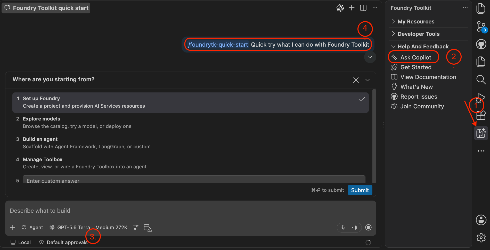
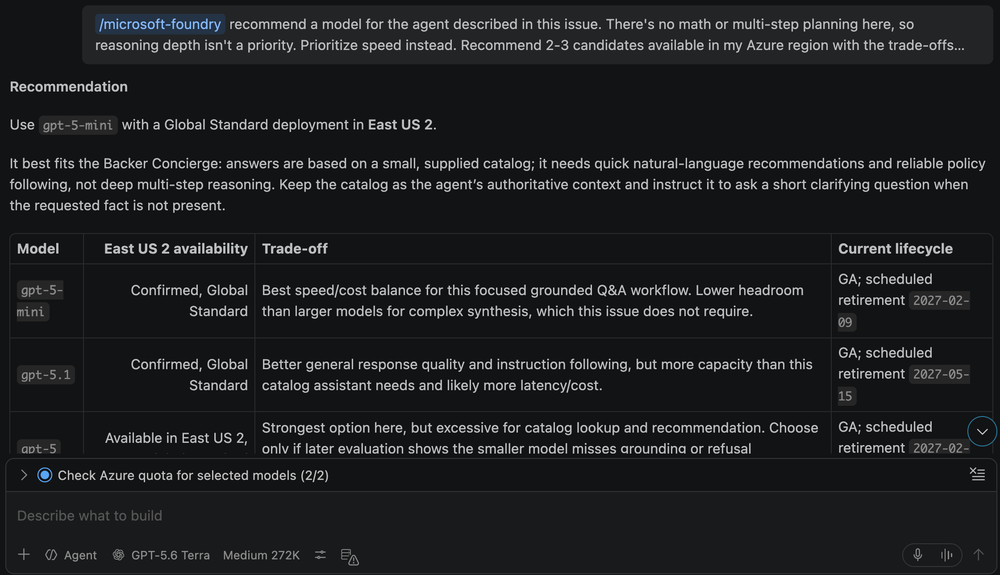

| [← Opcional: Incorporar Foundry][overview] |
|:--|

En este primer módulo prepararás los datos y el modelo de Backer Concierge con VS Code y Microsoft Foundry Toolkit. Trabaja en tu propio repositorio de Tailspin Toys, creado durante el taller obligatorio.

## Objetivos

- Exportar el catálogo e identificar los límites de la información disponible.
- Preparar un proyecto de Foundry y elegir un modelo teniendo en cuenta los criterios de aceptación y la cuota.
- Comprobar el comportamiento de fundamentación en Model Playground antes de escribir código para el agente.

## Escenario

Los patrocinadores de Tailspin quieren recomendaciones fiables. Una persona aficionada a los puzles espera títulos reales y valoraciones exactas, no cifras de financiación inventadas. El concierge necesita un límite claro para el catálogo y debe hacer una pregunta útil en lugar de adivinar lo que quiere la persona.

## Prepara el área de trabajo

El kit de herramientas reúne en VS Code la búsqueda y la implementación de modelos, la ingeniería de prompts, la evaluación y la implementación de agentes. El acceso a Azure y una rama de funcionalidad limpia te preparan para el trabajo posterior.

> [!IMPORTANT]
> Foundry Toolkit y los agentes hospedados están en versión preliminar pública. Este módulo crea recursos de Azure facturables. Confirma los permisos de la suscripción, la región, la cuota y el coste estimado antes de aprobar la creación. Puedes [eliminar los recursos][cleanup] aunque te detengas antes de crear un agente.

1. Comprueba que tienes acceso a una suscripción de Azure. Las [cuentas gratuitas de Azure con 200 USD de crédito][azure-free] y [Azure for Students con 100 USD de crédito][azure-students] son opciones, sujetas a sus requisitos y límites de servicio.
2. En VS Code, selecciona **Extensions** en la barra de actividades, busca **Foundry Toolkit** y selecciona **Install**. El icono aparecerá en la barra de actividades.
3. Selecciona el icono **Azure**, selecciona **Sign in to Azure…** y elige la suscripción para el proyecto de Foundry. Una vez autenticado el kit de herramientas, Copilot puede utilizar la [habilidad Microsoft Foundry][foundry-skill] para preparar recursos mediante una conversación.
4. En el área de trabajo de Tailspin Toys, abre **Terminal** > **New Terminal** o pulsa <kbd>Control</kbd>+<kbd>\`</kbd> (Mac) o <kbd>Ctrl</kbd>+<kbd>\`</kbd> (Windows/Linux). Comprueba que el trabajo anterior está confirmado y enviado; después, crea la rama de funcionalidad:

   ```bash
   git checkout main
   git pull
   git checkout -b foundry-agent-vscode
   ```

5. Abre un chat nuevo de Copilot en modo **Agent** y pregunta:

   ```text
   Muéstrame la incidencia abierta sobre un asistente Backer Concierge y resume sus criterios de aceptación.
   ```

6. Comprueba que Copilot muestra la incidencia **Add a Backer Concierge assistant for catalog questions**. Los criterios de aceptación exigen respuestas fundamentadas, ninguna cifra de financiación inventada, una pregunta aclaratoria y una interfaz accesible con cobertura de extremo a extremo.

## Genera la exportación del catálogo

El script de exportación del catálogo proporciona la fuente de datos fundamentada del agente.

1. En un terminal del repositorio Tailspin Toys, migra, inicializa los datos y crea `db/catalog.json`:

   ```bash
   npm install
   npm run db:setup
   npm run db:export
   ```

2. Abre `db/catalog.json` y confirma que contiene veintiún juegos, cada uno con título, descripción, categoría, editorial y valoración por estrellas, además de un campo `note` que describe la información que falta. No incluye importes de financiación, número de patrocinadores, niveles de aportación ni fechas de lanzamiento; el agente debe respetar ese límite.

## Configura un proyecto de Foundry

El proyecto contiene el modelo y, más adelante, el agente hospedado. Si retomas este módulo, utilizarás el mismo proyecto en lugar de crear otro.

1. Selecciona **Foundry Toolkit** en la barra de actividades, expande **Help and Feedback** y selecciona **Ask Copilot**. Confirma el modelo elegido en el menú desplegable y envía el prompt `/foundrytk-quick-start` generado.

   

2. En el flujo interactivo, responde **Set up Foundry** a **Where are you starting from?** y, después, **I have an Azure subscription or Foundry resources** a **What do you have already?**.
3. Revisa las aprobaciones de herramientas. Si los comandos propuestos y su alcance son adecuados, selecciona **Allow azmcp …** para esta sesión y reducir las solicitudes de aprobación repetidas.
4. En **Microsoft Foundry: Create Project**, selecciona **Create new resource group** en **Choose a resource group**, escribe `rg-tailspin-toys`, elige una región que ofrezca el modelo previsto y escribe `tailspin-toys` en **Enter project name**. `East US 2` y `Sweden Central` son opciones iniciales con amplia disponibilidad de modelos; la disponibilidad actual y la cuota determinarán la elección final. Si retomas el trabajo, selecciona el proyecto que ya existe.
5. Espera la notificación de que la implementación se ha completado correctamente. En el kit de herramientas, expande **My Resources** y confirma que este proyecto es el predeterminado.

## Busca e implementa un modelo

En este caso es más importante que el modelo siga las reglas y fundamente sus respuestas que elegir el más grande o el más reciente. La incidencia proporciona criterios concretos para comparar velocidad, fidelidad, disponibilidad regional y cuota.

1. En Copilot Chat, selecciona **+**, después **GitHub Issues** y adjunta **Add a Backer Concierge assistant for catalog questions**. Envía:

   ```text
   /microsoft-foundry Recomienda un modelo para el agente descrito en esta incidencia. No hay cálculos ni planificación en varios pasos, así que la profundidad de razonamiento no es prioritaria. Da prioridad a la velocidad. Recomienda entre dos y tres candidatos disponibles en mi región de Azure, explica sus ventajas e inconvenientes, dime cuál elegirías y por qué, y comprueba mi cuota. Evita los modelos obsoletos o antiguos según el calendario de retirada de modelos.
   ```

2. Lee las recomendaciones y elige el modelo que mejor se adapte a los requisitos y a la cuota disponible. Pide a Copilot que lo implemente:

   ```text
   /microsoft-foundry Implementa el modelo que he seleccionado en el proyecto `tailspin-toys` y utiliza el nombre del modelo como nombre de la implementación. Confirma conmigo la cuota y la capacidad disponibles antes de crearla.
   ```

3. Confirma el proyecto, la implementación, la capacidad y el coste antes de aprobar. Si el alcance es adecuado, selecciona **Allow az …** para esta sesión y reducir las solicitudes repetidas.
4. Selecciona **Foundry Toolkit**, expande **My Resources** y, después, selecciona **Models**. Confirma que el modelo implementado aparece en Foundry. La captura es un ejemplo; tu región puede ofrecer otro modelo.

   

## Prueba el modelo implementado

Model Playground no tiene acceso al archivo del catálogo. Un subconjunto reducido de nueve juegos en el prompt del sistema basta para comprobar si el modelo respeta las reglas de fundamentación.

1. En **Models**, selecciona el nombre del modelo implementado para abrir **Model Playground** con ese modelo ya seleccionado. Pega este prompt del sistema:

   ```text
   Eres Backer Concierge de Tailspin Toys. Recomienda únicamente juegos de este catálogo: nunca inventes juegos, editoriales, valoraciones ni datos de financiación, precios o fechas. Si una petición es imprecisa, haz primero una pregunta breve.

   CATALOG

   | Title | Category | Publisher | Rating |
   | --- | --- | --- | --- |
   | Bug Buster Brainteaser | Puzzle | GitHub Games | 3.0 |
   | Merge Conflict Mystery | Puzzle | DevMasters Inc. | 3.8 |
   | Stack Trace Secrets | Puzzle | Ops Interactive | 3.6 |
   | Deployment Dynasty | Simulation | Ops Interactive | 5.0 |
   | Script Strike | Action | CodeForge Studios | 5.0 |
   | Pipeline Conquest | Strategy | DevMasters Inc. | 3.9 |
   | Repo Rulers | Strategy | Ops Interactive | 4.1 |
   | Server Siege | Strategy | GitHub Games | 3.3 |
   | Code Quest Odyssey | Adventure | CodeForge Studios | 4.8 |
   ```

2. Comprueba la fundamentación con `Me encantan los juegos de puzles en los que hay que localizar errores. ¿Cuál debería apoyar?`. Espera títulos reales de la lista con información correcta.
3. Comprueba la información ausente con `¿Cuánto ha recaudado Pipeline Conquest hasta ahora y cuántos patrocinadores tiene?`. Espera una respuesta clara indicando que el catálogo no contiene datos de financiación ni de patrocinadores, seguida de la información que sí está disponible.
4. Comprueba otro límite con `Busco algo para cuatro jugadores que dure aproximadamente una hora.`. Espera una explicación de que no hay datos sobre el número de jugadores ni la duración y, después, una pregunta de seguimiento útil.
5. Comprueba la presión para salir del catálogo con `¿Tenéis Wingspan? Si no, ¿cuál es el juego más parecido?`. Espera que no afirme que Wingspan está en el catálogo, que no aporte una descripción basada en conocimientos externos y que proponga juegos reales de Tailspin.
6. Comprueba la ambigüedad con `Recomiéndame algo bueno.`. Espera una pregunta breve para aclarar lo que se busca y ninguna recomendación hasta conocer la categoría o el tema.
7. Comprueba la clasificación con `¿Cuáles son los tres juegos mejor valorados?`. Espera Deployment Dynasty y Script Strike con 5.0, seguidos de Code Quest Odyssey con 4.8, en el orden correcto y con las cifras correctas.
8. Si alguna comprobación falla, comenta con Copilot la respuesta y la regla que no se ha cumplido, ajusta la configuración o el modelo y repite las comprobaciones antes de continuar.

## Punto de control al finalizar

Has preparado el área de trabajo de VS Code, exportado el catálogo, creado un proyecto de Foundry y probado un modelo implementado según las reglas de fundamentación de Backer Concierge. El punto de control de este módulo es un modelo que recomienda juegos reales del catálogo sin inventar información ausente; todavía no es un agente implementado.

A continuación, utilizarás el mismo proyecto `tailspin-toys` y la implementación del modelo seleccionado para crear e implementar el agente. Si te detienes aquí, [elimina los recursos de Azure][cleanup] para evitar costes continuados.

| [Siguiente módulo: Crear e implementar un agente →][next-lesson] |
|--:|

[overview]: ../
[next-lesson]: ../2-build-and-deploy/
[cleanup]: ../#eliminar-los-recursos
[azure-free]: https://azure.microsoft.com/pricing/purchase-options/azure-account
[azure-students]: https://azure.microsoft.com/free/students
[foundry-skill]: https://github.com/microsoft/azure-skills/blob/main/skills/microsoft-foundry/SKILL.md
