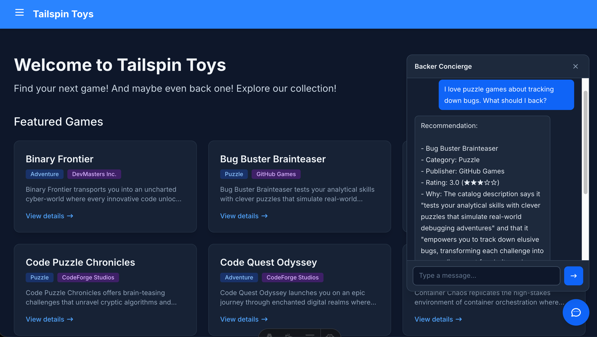

| [← Módulo anterior: Crear e implementar un agente][previous-lesson] |
|:--|

Este módulo conecta a Tailspin Toys el agente hospedado de [Crear e implementar un agente][previous-lesson]. Copilot Chat en VS Code crea una integración local, no un punto de conexión público de producción.

## Objetivos

- Mantener las credenciales y los identificadores de conversación de Foundry detrás de un proxy local del lado del servidor.
- Añadir un widget de chat accesible con continuidad de la conversación.
- Verificar el backend y la experiencia completa antes de eliminar los recursos.

## Escenario

Los patrocinadores deben poder pedir consejo al asistente sin salir del catálogo. Una conversación necesita conservar el contexto, funcionar con el teclado y proteger los datos privados de conexión. La confianza depende tanto de las recomendaciones honestas como de una experiencia segura y accesible.

## Retomar el área de trabajo

El agente hospedado existente es el destino de la integración. Tailspin Toys es un sitio web estático completamente prerenderizado, por lo que el código del navegador no puede almacenar las credenciales del agente de forma segura.

1. Abre el mismo repositorio de Tailspin Toys en `foundry-agent-vscode` en VS Code. Confirma que el agente hospedado del punto de control anterior sigue en estado **Running** en el proyecto `tailspin-toys` existente y que el inicio de sesión local de Azure apunta a su suscripción.
2. Abre Copilot Chat en el modo **Agent** normal en lugar de **AIAgentExpert**. Adjunta **Add a Backer Concierge assistant for catalog questions**: selecciona **+**, después **GitHub Issues** y elige la incidencia.

## Crear y verificar el proxy local

Un proxy local de Azure Functions en `/api` almacena los datos de conexión y reenvía las solicitudes mientras el sitio se ejecuta localmente. Copilot puede utilizar **Azure skills** para prepararlo y validarlo.

> [!IMPORTANT]
> Este proxy del taller es solo para desarrollo local. No lo implementes como un punto de conexión público anónimo. La producción requiere autenticación y controles contra el abuso específicos de la aplicación, incluidos límites de frecuencia o cuotas, restricciones de CORS, supervisión y controles de costes.

1. Pide a Copilot que cree el proxy:

   ```text
   Añade un proxy local de Azure Functions en `api` para que el sitio estático de Astro pueda llamar de forma segura a mi Backer Concierge implementado durante el desarrollo. Utiliza mi sesión local de Azure para llamar al agente hospedado, mantén todas las credenciales fuera del navegador, protege el estado de la conversación con identificadores opacos, valida las solicitudes, sanea los errores, añade pruebas específicas y configura el servidor de desarrollo de Astro para que las solicitudes a `/api` lleguen a la Function local. No crees infraestructura pública para la implementación.
   ```

2. Revisa los cambios antes de aceptarlos. Confirma que las credenciales y los identificadores de conversación de Foundry permanecen en el servidor, que los ajustes locales se excluyen del control de versiones, que las solicitudes tienen límites y que las pruebas específicas pasan.
3. Demuestra que el backend funciona antes de crear la interfaz:

   ```text
   Inicia el host local de Functions y prueba `/api/concierge` con la pregunta «¿Qué juegos cuestan menos de 30 $?». Muéstrame la respuesta saneada y confirma que no se devuelven credenciales ni identificadores internos de conversación.
   ```

4. Comprueba la respuesta del terminal. Debes obtener JSON válido con una propiedad `response` que contenga la respuesta, sin información de precios inventada, credenciales ni identificadores de conversación internos. Si alguna comprobación falla, pide a Copilot que la corrija y repite la prueba del backend.
5. Selecciona **Keep** para conservar los cambios y utiliza **/clear** para empezar de cero con el widget en el mismo repositorio y la misma rama. Conserva la configuración del proxy local y la conexión con el agente hospedado existente.

## Crear y probar el widget

La interfaz ya tiene un backend verificado. Las pruebas de extremo a extremo comprueban tanto la usabilidad como los límites de información del catálogo.

1. Pide a Copilot que añada el widget:

   ```text
   Añade al sitio Astro un widget de chat accesible de Backer Concierge. Conéctalo a `/api/concierge`, conserva la conversación mediante el identificador opaco devuelto, sigue las directrices de diseño existentes, permite usarlo con el teclado y asegúrate de que se pueda probar.
   ```

   

2. Mantén la función y el sitio en ejecución y, a continuación, verifica la experiencia completa:

   ```text
   Utiliza Playwright MCP para probar el widget Backer Concierge de extremo a extremo. Comprueba el flujo básico del chat, la continuidad de la conversación, el uso del teclado y la accesibilidad, los límites de fundamentación y el uso seguro del proxy local. Informa de los resultados y corrige los fallos.
   ```

3. Revisa los resultados de las pruebas y los cambios frente a los criterios de aceptación de la incidencia: respuestas fundamentadas en los datos, ausencia de cifras de financiación inventadas, una pregunta aclaratoria, una interfaz accesible y cobertura de pruebas de extremo a extremo. Confirma que se han corregido los fallos y se han vuelto a ejecutar las comprobaciones afectadas.

## Punto de control al finalizar

Has creado un proxy local que protege las credenciales, has conectado un widget de chat accesible y has verificado el flujo completo de conversación con el Backer Concierge hospedado. El punto de control de este módulo es una integración del sitio probada localmente que respeta los límites del catálogo y mantiene las credenciales y los identificadores internos de Foundry fuera del navegador. No es una implementación de producción del proxy ni del sitio.

Cuando termines de experimentar, detén los servicios locales y [elimina los recursos de Azure][cleanup] para evitar costes continuados. Después, vuelve a la [introducción a VS Code][vscode-overview] del taller principal.

[previous-lesson]: ../2-build-and-deploy/
[cleanup]: ../#eliminar-los-recursos
[vscode-overview]: ../../
